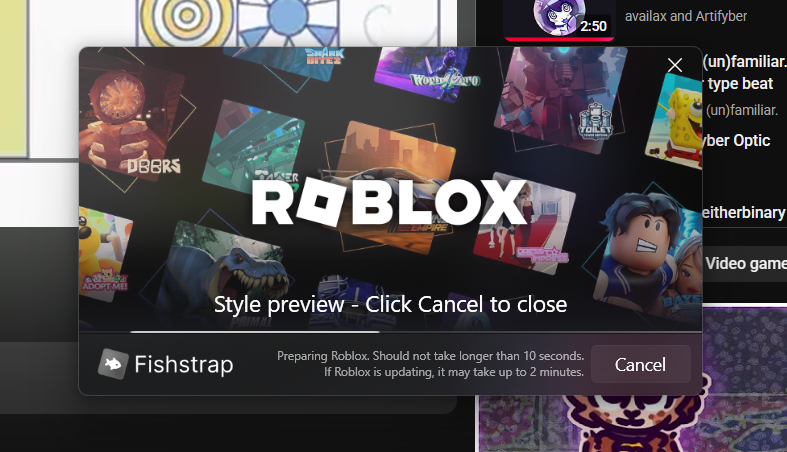

# Unified Bootstrapper for Bloxstrap/Fishstrap
> [!WARNING]
> A lot of theme file has "unauthorized" image in them, such as Roblox logo and such, we do not affiliates with them, and I got it off from Google Images.
> To the rightful owner of that image, if you ever need me to remove a specific image, let me know via Direct Messages.
> The MIT License will not be covered over the image, and only cover software **Theme.xml** related.

> [!IMPORTANT]
> Some of the file is only tested for **[Bloxstrap](https://bloxstraplabs.com/)** or **[Fishstrap](https://fishstrap.app/)**, I cannot guarantee if the file will work in other applications like **[Voidstrap](https://github.com/KloBraticc/Voidstrap)**, if you use the Unified Bloxstrapper 2.1 and later, it's recommended that you use **Fishstrap** only instead of **Bloxstrap** to avoid XAML error.

Tired of boring ass Roblox launcher interface, Bloxstrap and Fishstrap bootstrapper style isn't your taste? No worries! This bootstrapper repository I made during my "absurdly big" free time break will elevate your bootstrapper style to the next level! Like, literally.

## What this repository offers you;
- A revamped bootstrapper interface!
- Open-sourced project, meaning you can take, use it, modify it, whatever you want!
- Flex flex, something, completely up to you!

For more information about each version of Bloxstrapper, check [README2.md](https://github.com/rblx-randal/Unified-Bloxstrapper/blob/main/Every%20single%20Bootstrapper/README2.md)

## How to install it to Bloxstrap or Fishstrap?
To download a folder [not each individual files, who would do that], use [downgit.github.io](https://downgit.github.io/)

Depends on how you install it, there's two options;

***Option 1***
- Download specific bootstrapper version you want and install the files.
- Go to **%LocalAppData%/Fishstrap/CustomThemes** in file explorer | If you use Bloxstrap instead, replace **"Fishstrap"** in the address bar with **"Bloxstrap"**.
- Copy or Cut the installed files and paste it over to CustomThemes folder.
- If you cannot do Option 1 because it's confusing, move to Option 2.

***Option 2***
- Download specific bootstrapper version you want and install the files.
- Go to Fishstrap or Bloxstrap app and press **"Configure settings"**
- Click on **"Mods"**, then **"Open Mods Folder"**
- It will open File Explorer, you should then press on **"Fishstrap"** or **"Bloxstrap** on the File Explorer's **Address bar**.
- Press on CustomThemes folder, and then copy or cut the installed files and paste it over CustomThemes folder.
- Congratulations! That's basically it.

If you still cannot install the theme correctly, or lost, I can't really help, maybe ask your friend who knows tech well, they could help you out!

> [!NOTE]
> When Bootstrapper V1 came into existence, it was mostly vibecoded, I don't have the correct knowledge to make a custom theme correctly.
> Until around V1.1 and V1.2 Prototype, I just rely AI as a suggestion, and maybe some of you guys suggestion as well.
> If you 100% do not support AI and against it, please don't download any of our bootstrapper, no offense, I'm sorry.
